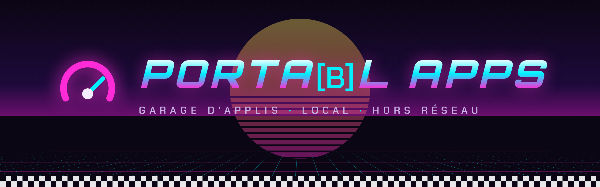
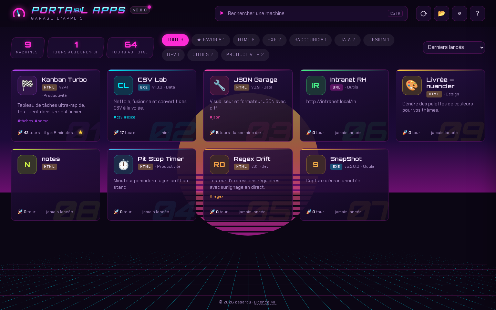
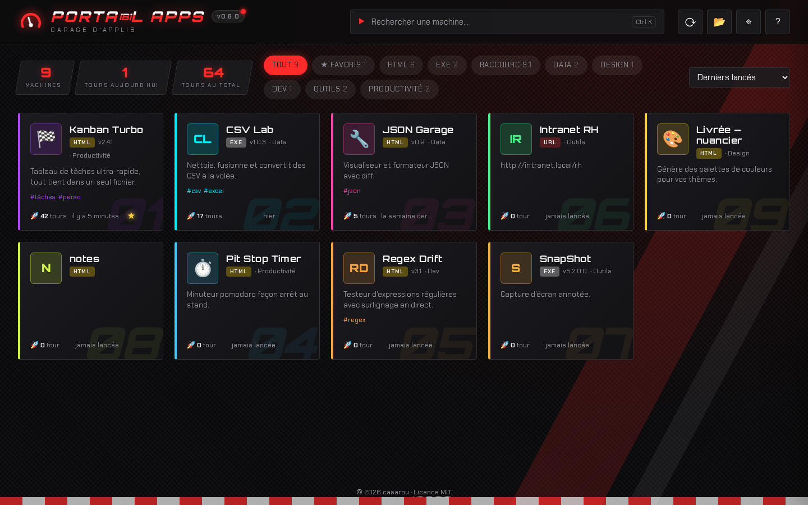
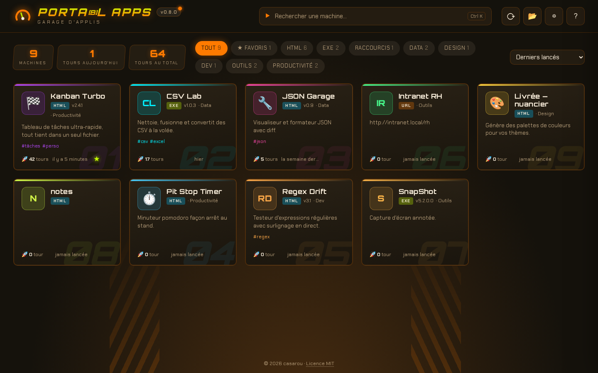
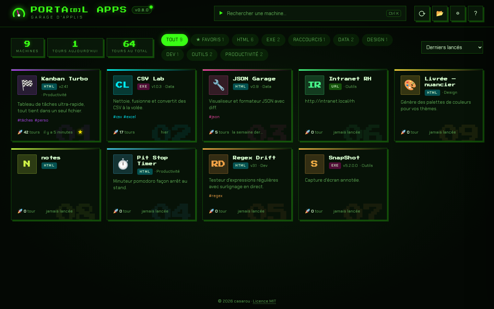
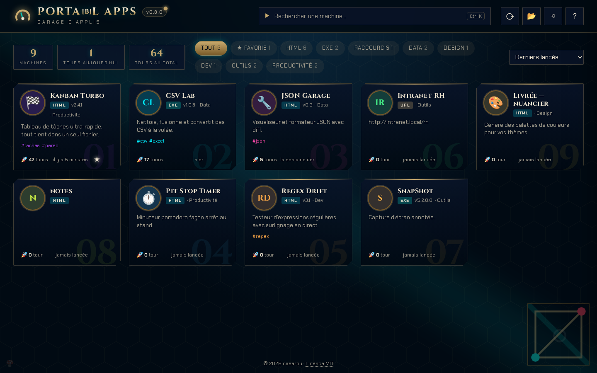
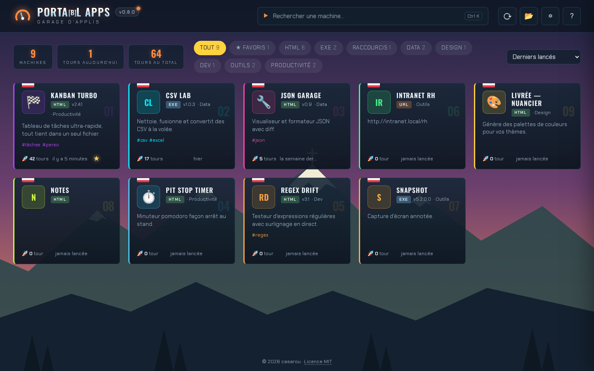

<div align="center">



**Le lanceur local de tes applis standalone.**
Dépose tes `.html`, `.exe` et raccourcis dans un dossier : ils deviennent des cartes, prêtes à démarrer.

[](https://github.com/eowindel/portabl-apps/actions/workflows/build.yml)
[](LICENSE)


[English](README.md) · **Français**

</div>

---

## En bref

- **Un seul exécutable de ~4 Mo**, sans installation, sans compte, **hors réseau** : rien ne sort de ta machine.
- **Zéro configuration** : tout dossier est scanné, chaque appli est décrite par ses propres métadonnées (balises HTML, infos de version de l'exe, raccourci…).
- **Pensé pour lancer vite** : recherche instantanée, favoris, compteur de lancements, navigation au clavier.
- **Plusieurs thèmes** : Néon Arcade, Superbike, Enduro, 8-bit, Hextech, Sommet.
- **Sans framework** : l'interface est du HTML/CSS/JS pur dans une coque [Tauri 2](https://tauri.app).



<details>
<summary>Les autres thèmes</summary>

| | |
|---|---|
|  |  |
|  |  |
|  | |

</details>

## Installation

Télécharge le binaire de ta plateforme depuis les [Releases](https://github.com/eowindel/portabl-apps/releases) :

| Plateforme | Fichier |
|---|---|
| Windows 10/11 | `portabl-apps-windows-x86_64.exe` |
| Linux x86_64 | `portabl-apps-linux-x86_64` (`chmod +x`) |

Windows requiert WebView2 (présent sur Windows 11 et les Windows 10 à jour). Sous Linux, il faut WebKitGTK 4.1 (`libwebkit2gtk-4.1`).

## Utilisation

```
PortablApps/
├── portabl-apps(.exe)
├── portabl-apps.json   ← réglages, favoris, compteurs (créé automatiquement)
└── apps/               ← déposez vos applis ici
    ├── MonOutil.html
    ├── MonOutil.portal.json   (optionnel)
    ├── Convertisseur.exe
    └── GrosseAppli/           (sous-dossier : index.html, un seul .exe, un seul raccourci, ou portal.json avec "entry")
```

Le dossier est rescanné à chaque retour sur la fenêtre (ou F5). Le dossier scanné se change dans les réglages ⚙.

**Raccourcis clavier** : taper = rechercher · `Ctrl K` · flèches pour naviguer · `Entrée` lancer · `F` favori · `I` / clic droit détails · `E` modifier la fiche · `Échap`.

**Applis HTML** : par défaut, chacune s'ouvre dans sa propre fenêtre de navigateur en mode appli (sans onglets) : Edge sous Windows, Chromium / Chrome / Brave / Edge sous Linux. Alternatives dans les réglages : navigateur par défaut, ou navigateur perso avec arguments (`{url}`).

> **Linux** : les applis `.html` se lancent normalement ; les `.exe` et raccourcis `.lnk` / `.url` s'affichent mais ne se lancent que sous Windows.

## Décrire ses applis

Par ordre de priorité :

1. **`MonAppli.portal.json`** à côté du fichier (ou `portal.json` dans le dossier de l'appli), à écrire à la main ou avec l'éditeur ✏️ de l'appli (touche `E`) :
   ```json
   {
     "name": "Mon Appli", "description": "…", "version": "1.2.0", "author": "Moi",
     "category": "Outils", "tags": ["csv"], "color": "#00f0ff",
     "icon": "🏍️", "notes": "…", "hidden": false, "entry": "app.html"
   }
   ```
   `icon` : emoji ou fichier image (`png`, `svg`, `ico`…). `entry` : seulement pour un dossier.
2. **Balises du HTML** : `<title>`, favicon, `<meta name="description|author|version">`
   et `<meta name="portal:category|portal:tags|portal:color|portal:icon|portal:notes">`.
3. **Raccourcis** : un `.lnk` donne sa description et son icône (ou celle de sa cible), un `.url` son adresse et son icône ; le nom est celui du fichier.
4. **Infos de version de l'exe** : description, version, société, commentaires + icône.

### Skill Claude Code

[`skills/portabl-apps-meta/`](skills/portabl-apps-meta) est un skill [Claude Code](https://claude.com/claude-code) qui renseigne ces infos au bon endroit dans tes autres projets (balises HTML, ressources de l'exe, `.portal.json`). Il fournit aussi `check.mjs`, qui affiche la carte telle que le lanceur la verra :

```bash
node skills/portabl-apps-meta/check.mjs chemin/vers/appli.html
```

Pour l'utiliser dans tous tes projets, copie le dossier dans `~/.claude/skills/` (`%USERPROFILE%\.claude\skills\` sous Windows), à refaire après chaque modification du skill ou des règles de détection de `scan.rs`.

## Développement

Prérequis : Node.js, Rust (`rustup`). Windows : MSVC Build Tools. Linux : `libwebkit2gtk-4.1-dev libgtk-3-dev libxdo-dev libssl-dev librsvg2-dev libayatana-appindicator3-dev`.

```bash
npm install
npm run dev      # appli en mode dev
npm run build    # → src-tauri/target/release/portabl-apps(.exe)
cd src-tauri && cargo test
```

- `src/` : interface (HTML/CSS/JS sans framework ni bundler). Thèmes dans `src/themes.css` + liste `THEMES` dans `src/app.js`.
- `src-tauri/src/scan.rs` : découverte et métadonnées · `lib.rs` : lancement et commandes · `settings.rs` : réglages.
- `node scripts/preview-server.mjs` : aperçu de l'interface dans un navigateur, avec un backend simulé.
- `demo-apps/` : applis de démo (les `.exe` de test ne sont pas versionnés).
- `npm run fonts` : recopie les polices et leurs licences OFL depuis `node_modules` vers `src/fonts`.
- `docs/` : sources de la bannière et captures du README.

### Publier une version

1. Changer `version` dans `src-tauri/Cargo.toml` : c'est la seule source, affichée dans le badge de l'appli (garder `package.json` aligné).
2. Ajouter une section en haut de `CHANGELOG.md` (`## [x.y.z] - AAAA-MM-JJ`, puis `### Ajouté` / `### Modifié` / `### Corrigé`). Le fichier est embarqué dans l'exe et affiché en cliquant sur le badge de version.
3. Commit, puis `git tag vx.y.z && git push --tags` : la CI compile Windows et Linux et publie les binaires dans une release GitHub.

## Sur un PC d'entreprise

- L'exe n'est pas signé : SmartScreen ou AppLocker peuvent le bloquer selon la politique de l'entreprise.
- Si le dossier de l'exe n'est pas accessible en écriture, les réglages ne sont pas sauvegardés : place l'appli dans un dossier utilisateur.

## Licence

[MIT](LICENSE) © 2026 casarou. Les polices embarquées dans `src/fonts/` sont sous licence OFL (voir les fichiers `LICENSE-*.txt`).
