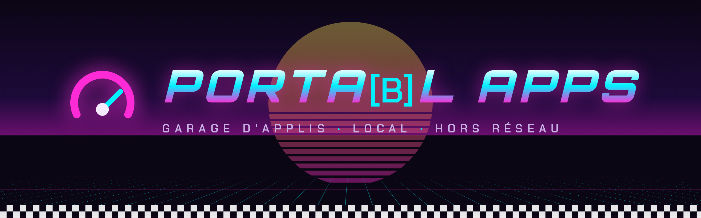
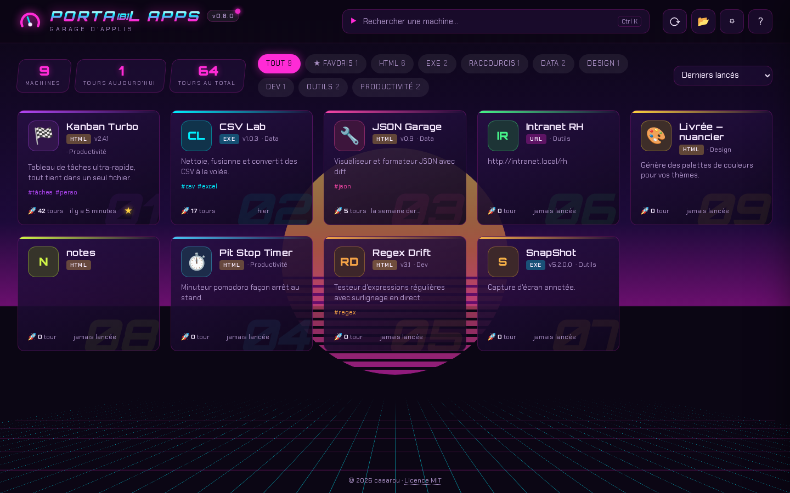
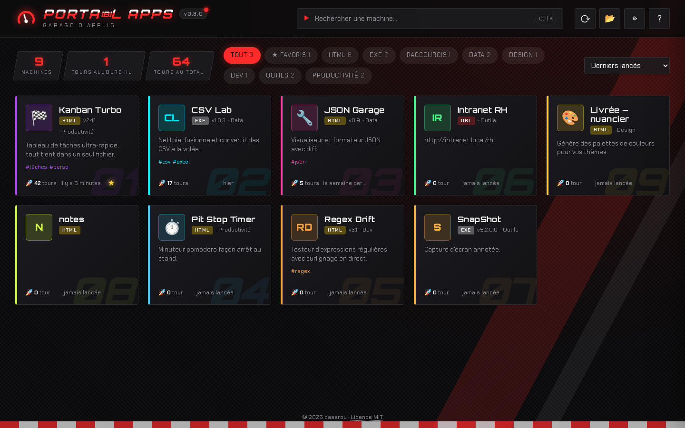
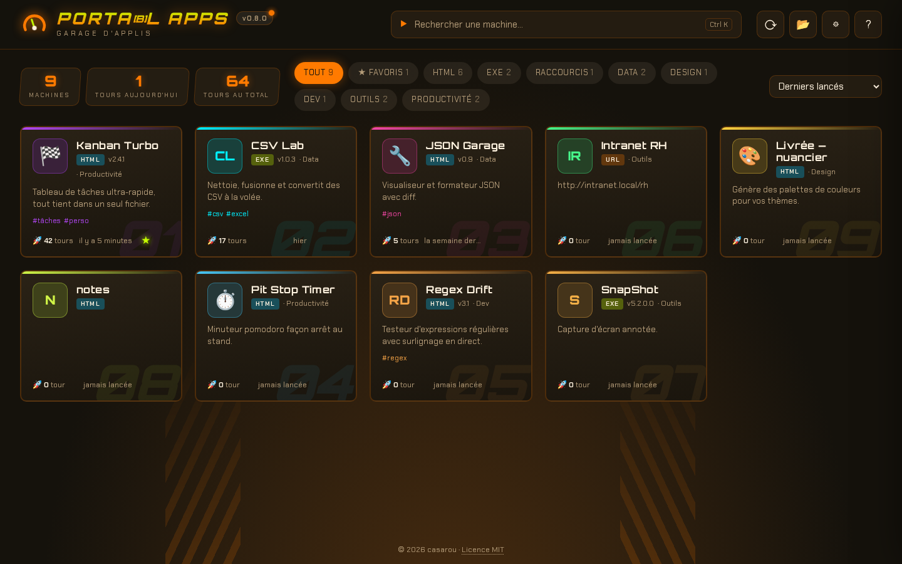
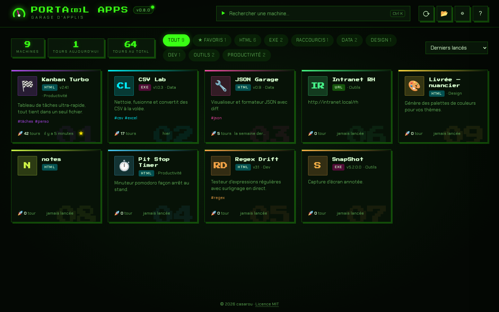
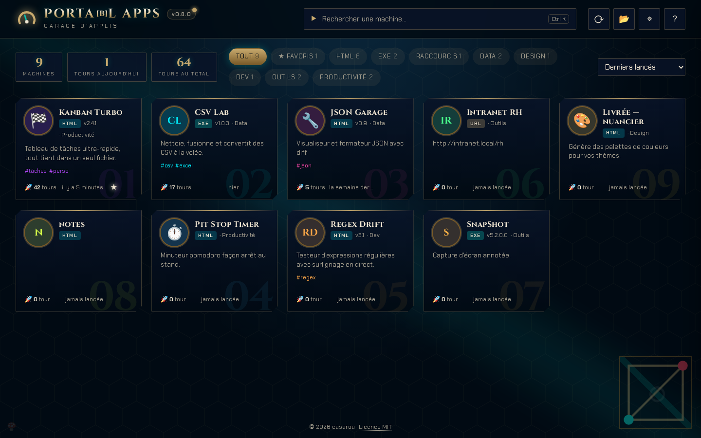
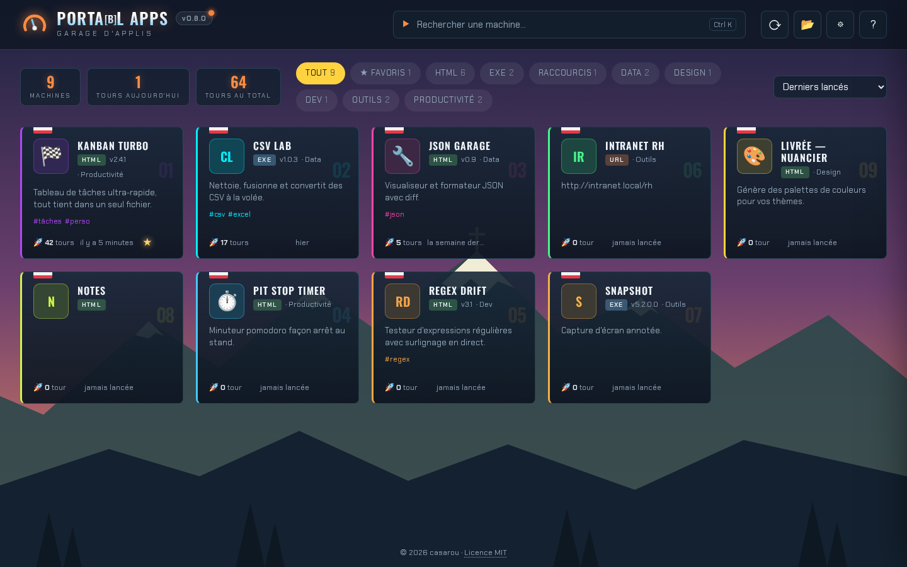

<div align="center">



**A local launcher for your standalone apps.**
Drop your `.html`, `.exe` and shortcuts in a folder: they become cards, ready to start.

[](https://github.com/eowindel/portabl-apps/actions/workflows/build.yml)
[](LICENSE)


**English** · [Français](README.fr.md)


https://github.com/user-attachments/assets/6ff1a0c2-4b54-4906-993f-a02df4cf1429


</div>

---

## At a glance

- **One ~4 MB executable**: no installer, no account, **fully offline**. Nothing leaves your machine.
- **Zero configuration**: point it at a folder and every app is described by its own metadata (HTML tags, exe version info, shortcut…).
- **Built to launch fast**: instant search, favorites, launch counters, full keyboard navigation.
- **Several themes**: Neon Arcade, Superbike, Enduro, 8-bit, Hextech, Summit.
- **No framework**: the UI is plain HTML/CSS/JS inside a [Tauri 2](https://tauri.app) shell.



<details>
<summary>More themes</summary>

| | |
|---|---|
|  |  |
|  |  |
|  | |

</details>

> The interface is currently in French.

## Install

Download the binary for your platform from the [Releases](https://github.com/eowindel/portabl-apps/releases) page:

| Platform | File |
|---|---|
| Windows 10/11 | `portabl-apps-windows-x86_64.exe` |
| Linux x86_64 | `portabl-apps-linux-x86_64` (`chmod +x`) |

Windows needs WebView2 (built into Windows 11 and up-to-date Windows 10). Linux needs WebKitGTK 4.1 (`libwebkit2gtk-4.1`).

## Usage

```
PortablApps/
├── portabl-apps(.exe)
├── portabl-apps.json   ← settings, favorites, counters (created automatically)
└── apps/               ← drop your apps here
    ├── MyTool.html
    ├── MyTool.portal.json    (optional)
    ├── Converter.exe
    └── BigApp/               (subfolder: index.html, a single .exe, a single shortcut, or portal.json with "entry")
```

The folder is rescanned whenever the window regains focus (or on F5). Change the scanned folder in the settings ⚙.

**Keyboard**: type to search · `Ctrl K` · arrows to move · `Enter` to launch · `F` favorite · `I` / right-click details · `E` edit the card · `Esc`.

**HTML apps** open by default in their own browser window in app mode (no tabs): Edge on Windows, Chromium / Chrome / Brave / Edge on Linux. Alternatives in the settings: default browser, or a custom browser with arguments (`{url}`).

> **Linux**: `.html` apps launch normally; `.exe` apps and `.lnk` / `.url` shortcuts are listed but only launch on Windows.

## Describing your apps

In order of priority:

1. **`MyApp.portal.json`** next to the file (or `portal.json` in the app folder), written by hand or with the in-app editor ✏️ (key `E`):
   ```json
   {
     "name": "My App", "description": "…", "version": "1.2.0", "author": "Me",
     "category": "Tools", "tags": ["csv"], "color": "#00f0ff",
     "icon": "🏍️", "notes": "…", "hidden": false, "entry": "app.html"
   }
   ```
   `icon`: an emoji or an image file (`png`, `svg`, `ico`…). `entry`: folders only.
2. **HTML tags**: `<title>`, favicon, `<meta name="description|author|version">`
   and `<meta name="portal:category|portal:tags|portal:color|portal:icon|portal:notes">`.
3. **Shortcuts**: a `.lnk` provides its description and icon (or its target's), a `.url` its address and icon; the name is the file name.
4. **Exe version info**: description, version, company, comments + icon.

### Claude Code skill

[`skills/portabl-apps-meta/`](skills/portabl-apps-meta) is a [Claude Code](https://claude.com/claude-code) skill that fills in this metadata in the right place in your other projects (HTML tags, exe resources, `.portal.json`). It also ships `check.mjs`, which prints the card as the launcher will see it:

```bash
node skills/portabl-apps-meta/check.mjs path/to/app.html
```

To use it in all your projects, copy the folder to `~/.claude/skills/` (`%USERPROFILE%\.claude\skills\` on Windows), and redo it after any change to the skill or to the detection rules in `scan.rs`.

## Development

Requirements: Node.js, Rust (`rustup`). Windows: MSVC Build Tools. Linux: `libwebkit2gtk-4.1-dev libgtk-3-dev libxdo-dev libssl-dev librsvg2-dev libayatana-appindicator3-dev`.

```bash
npm install
npm run dev      # app in dev mode
npm run build    # → src-tauri/target/release/portabl-apps(.exe)
cd src-tauri && cargo test
```

- `src/`: the UI (HTML/CSS/JS, no framework or bundler). Themes live in `src/themes.css` + the `THEMES` list in `src/app.js`.
- `src-tauri/src/scan.rs`: discovery and metadata · `lib.rs`: launching and commands · `settings.rs`: settings.
- `node scripts/preview-server.mjs`: preview the UI in a browser, with a mocked backend.
- `demo-apps/`: demo apps (test `.exe` files are not versioned).
- `npm run fonts`: copy fonts and their OFL licenses from `node_modules` to `src/fonts`.
- `docs/`: banner source and README screenshots.

### Releasing

1. Bump `version` in `src-tauri/Cargo.toml`: it is the single source, shown in the app's badge (keep `package.json` aligned).
2. Add a section at the top of `CHANGELOG.md` (`## [x.y.z] - YYYY-MM-DD`, then `### Ajouté` / `### Modifié` / `### Corrigé`). The file is embedded in the exe and shown when clicking the version badge.
3. Commit, then `git tag vx.y.z && git push --tags`: CI builds Windows and Linux and publishes the binaries to a GitHub release.

## On a corporate PC

- The exe is not signed: SmartScreen or AppLocker may block it depending on company policy.
- If the exe's folder is not writable, settings are not saved: put the app in a user folder.

## License

[MIT](LICENSE) © 2026 casarou. Fonts bundled in `src/fonts/` are under the OFL license (see the `LICENSE-*.txt` files).
